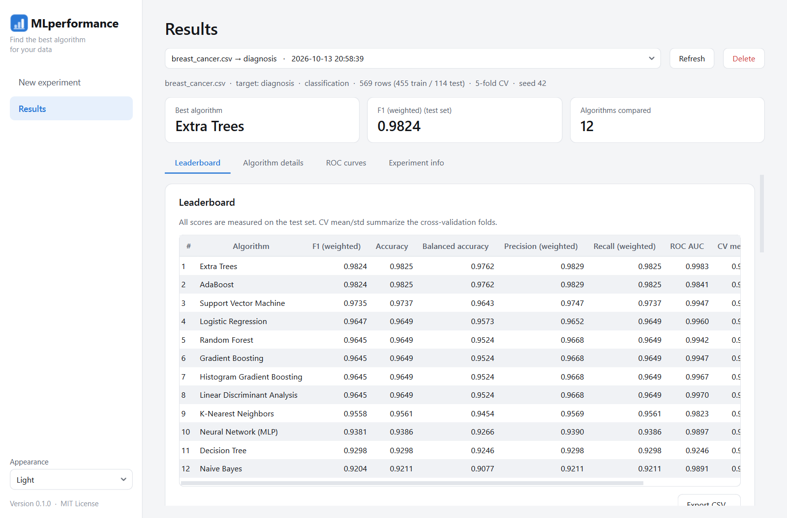
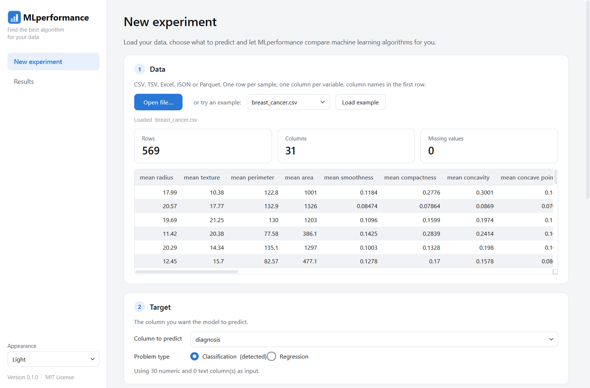
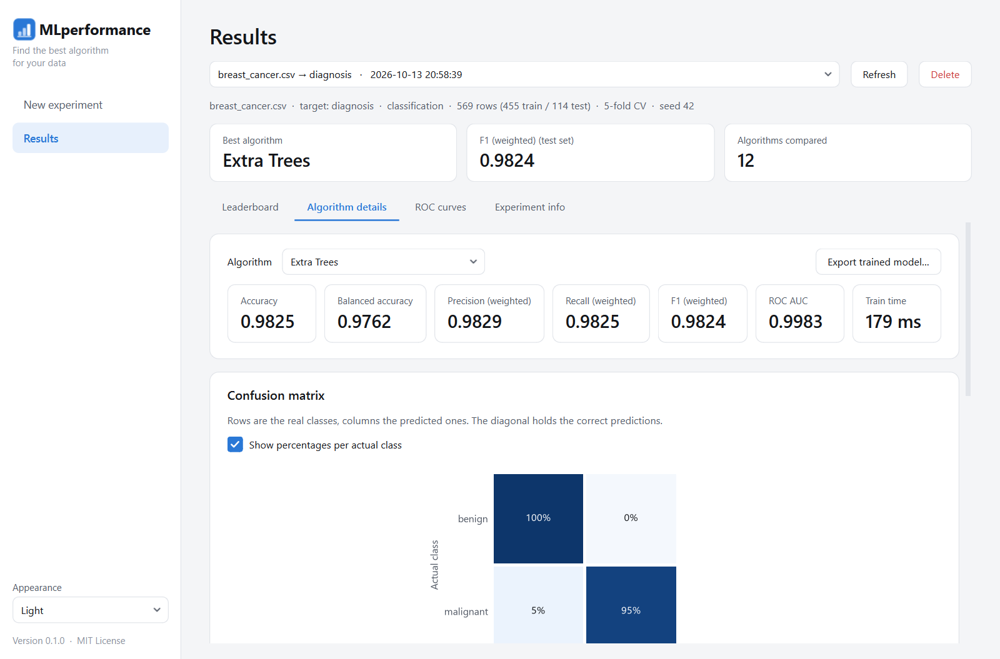
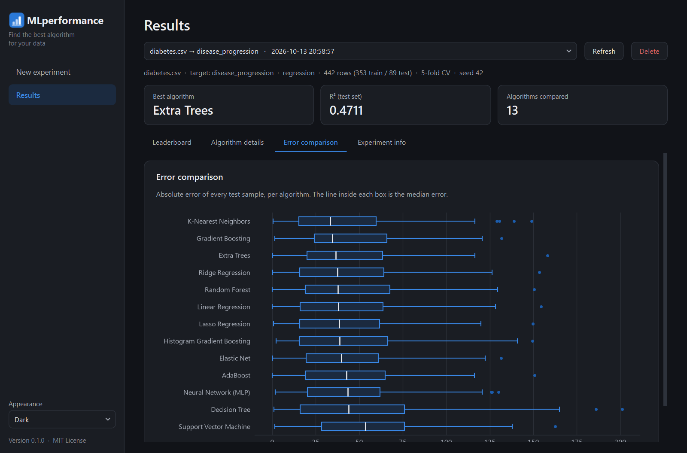

# MLperformance

**Find the best machine learning algorithm for your data, without writing code.**

People who are just getting started with machine learning often don't know which algorithm to use for their data. MLperformance is a desktop app that trains and compares many algorithms on your dataset and shows charts that explain which one performs best.

It runs **entirely on your computer**. Your data never leaves your machine.

> Open source under the [MIT License](LICENSE). Built for academic and educational purposes.



---

## Features

- **Import your own data**: CSV/TSV (the separator is detected automatically), Excel, JSON and Parquet.
- **Choose what to predict**: pick any column as the target. MLperformance detects whether the problem is **classification** (predicting a category) or **regression** (predicting a number), and you can override it.
- **Test one algorithm, some, or all of them**: 12 classifiers and 13 regressors from scikit-learn, plus XGBoost and LightGBM if they are installed.
- **Automatic preprocessing**: fills missing values, scales numeric columns, one-hot encodes text columns and ignores columns that cannot help (IDs, empty or constant columns).
- **Sound evaluation**: k-fold cross-validation on the training split plus a held-out test set.
- **Saved experiments**: every run is stored, so you can reopen it later and compare charts.
- **Charts for each algorithm** (hover over them for exact values):
  - Leaderboard and comparison by any metric
  - Cross-validation stability
  - Training time
  - Confusion matrix and ROC curves (classification)
  - Predicted vs. actual, error distribution and error comparison (regression)
  - Feature importance
- **Export** the leaderboard as CSV and trained models as `.joblib` files for your own Python code.
- **Light and dark themes**, following your system setting by default.
- **Command-line interface** for scripting and batch use.

| New experiment | Algorithm details | Dark mode |
|---|---|---|
|  |  |  |

## Download (Windows)

1. Download `MLperformance-windows.zip` from the [Releases](../../releases) page.
2. Extract the zip anywhere, for example to `Documents\MLperformance`.
3. Double-click **`MLperformance.exe`**.

You don't need to install Python. Windows SmartScreen may warn you the first time because the app is not code-signed. Click **More info → Run anyway**.

## Running from source (Windows, Linux, macOS)

You need **Python 3.10 or newer**.

```sh
git clone https://github.com/<your-user>/MLperformance.git
cd MLperformance
```

- **Windows**: double-click `run.bat`.
- **Linux / macOS**: run `./run.sh`.

The first run creates a virtual environment and installs the dependencies. To set it up by hand:

```sh
python -m venv .venv
# Windows: .venv\Scripts\activate    Linux/macOS: source .venv/bin/activate
pip install -r requirements.txt
python MLperformance.py
```

Optional extra algorithms:

```sh
pip install xgboost lightgbm
```

## Building the executable yourself

On Windows, run:

```bat
build.bat
```

This creates `dist\MLperformance\MLperformance.exe`, runs a self-test on the built app, and packages everything as `release\MLperformance-windows.zip`. You can also verify any build manually with `MLperformance.exe --self-test`. The exit code is 0 when the build is complete.

Pushing a version tag (for example `v0.2.0`) to GitHub builds the zip automatically and publishes it as a release.

## How to use

1. On **New experiment**, click **Open file…** or load one of the example datasets.
2. Choose the **column to predict**.
3. Keep **Test all algorithms** or pick specific ones.
4. Click **Train models**. The window stays responsive while training runs.
5. Click **Open results** to see the leaderboard and the charts for every algorithm.

The [User Guide](docs/USER_GUIDE.md) walks through each step and explains how to read every chart.

## Command line

```sh
python -m mlperformance train examples/iris.csv --target species
python -m mlperformance train examples/diabetes.csv --target disease_progression \
    --algorithms "Random Forest" "Ridge Regression"
python -m mlperformance algorithms   # list available algorithms
python -m mlperformance list         # list saved experiments
```

Experiments created from the command line also appear in the app.

## Using a trained model in Python

```python
import pandas as pd
from mlperformance.storage import load_model

model = load_model("random-forest.joblib")  # exported from the app
new_data = pd.read_csv("new_samples.csv")   # same columns as the training file
print(model.predict(new_data))
```

> Only load `.joblib` files that you trust: loading one can run arbitrary code.

## Where experiments are stored

| System | Folder |
|---|---|
| Windows | `%LOCALAPPDATA%\MLperformance\runs` |
| Linux / macOS | `~/.local/share/MLperformance/runs` |

Set the `MLPERFORMANCE_RUNS_DIR` environment variable to use another folder. The **Experiment info** tab shows the exact location.

## Documentation

| Document | Contents |
|---|---|
| [User Guide](docs/USER_GUIDE.md) | Step-by-step usage, data format, how to read each chart |
| [Algorithms & Metrics](docs/ALGORITHMS_AND_METRICS.md) | What each algorithm does and what each metric means |
| [Architecture](docs/ARCHITECTURE.md) | How the code is organized and how a run flows through it |
| [Contributing](CONTRIBUTING.md) | Development setup, tests, building and adding algorithms |

## Project structure

```
MLperformance/
├── MLperformance.py        # App launcher (also the executable's entry point)
├── MLperformance.spec      # PyInstaller build recipe
├── build.bat               # Builds the Windows executable and zip
├── mlperformance/
│   ├── data.py             # File loading
│   ├── preprocessing.py    # Task detection, feature selection, preprocessing
│   ├── models.py           # Algorithm registry
│   ├── trainer.py          # Training, cross-validation and metrics
│   ├── storage.py          # Saving and loading experiments
│   ├── __main__.py         # Command-line interface
│   └── gui/                # Desktop interface (PySide6 + matplotlib)
├── assets/                 # App icon
├── examples/               # Sample datasets
├── tests/                  # Automated tests (pytest)
└── docs/                   # Documentation
```

## Running the tests

```sh
pip install pytest
pytest
```

The interface tests open the real app windows off-screen and run full experiments.

## Limitations

- Date/time columns are ignored for now.
- Hyperparameters use sensible defaults; there is no automatic tuning yet.
- On very large datasets (hundreds of thousands of rows), SVM and KNN become slow. The app warns you before training.
- The prebuilt executable is for Windows. Linux and macOS users run from source.

## License

[MIT](LICENSE) © 2026 Bernardo Battisti. This project is intended for academic and educational use.
